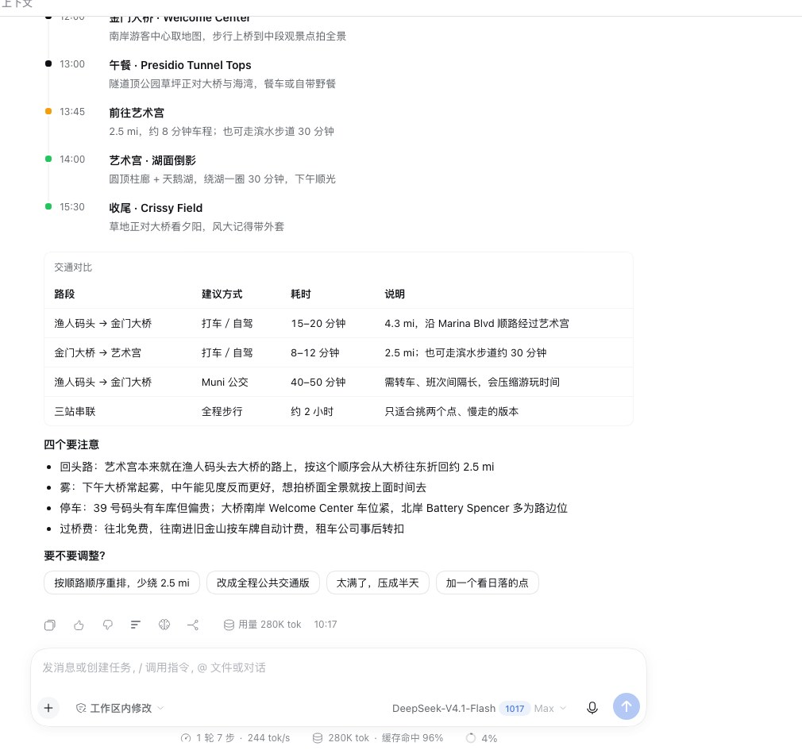
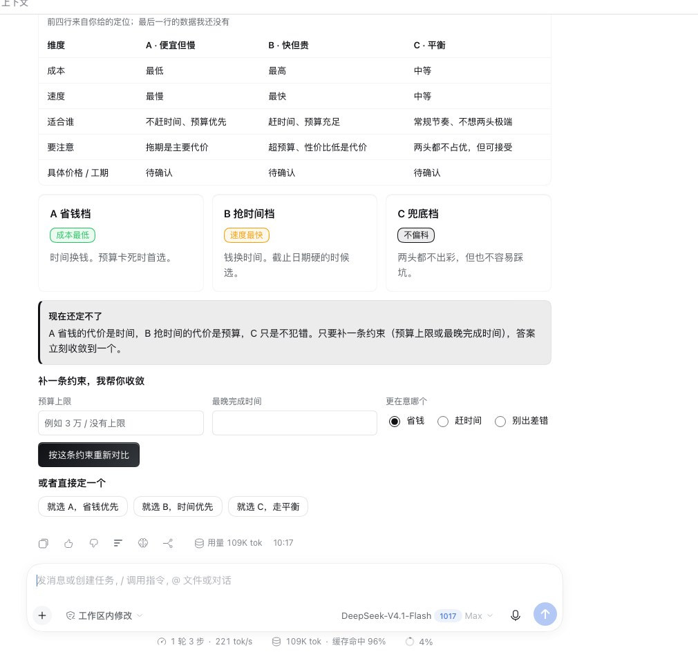
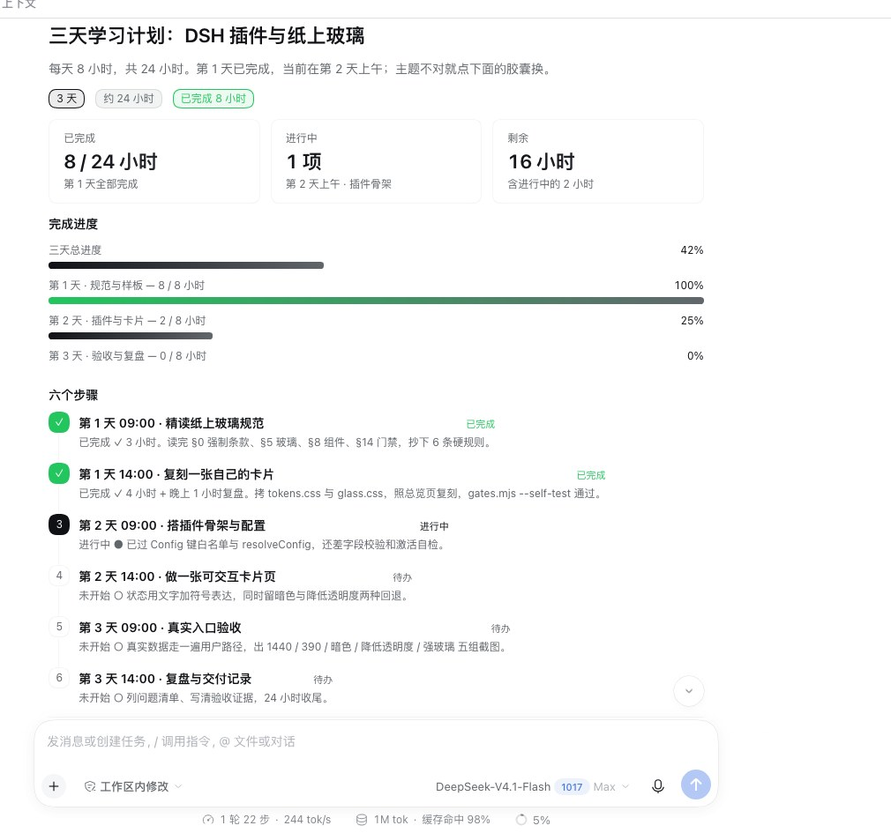
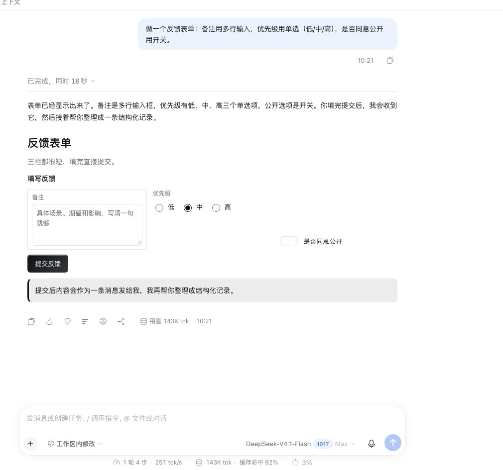
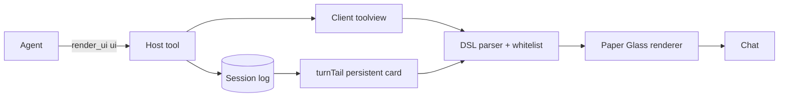

<div align="center">
  
  <h1>DSH Intelligent UI</h1>
  <p><strong>Answers as interfaces.</strong><br/>Turn DeepSeek Harness chat replies into Paper Glass cards you can read, click, and submit.</p>
  <p>
    <a href="https://github.com/simmon-clap/dsh-intelligent-ui/actions/workflows/ci.yml"></a>
    
    
    
    
    <a href="https://github.com/topics/dsh-plugin"></a>
    <a href="LICENSE"></a>
  </p>
  <p>
    <a href="#快速开始">快速开始</a> ·
    <a href="#它能做什么">能力</a> ·
    <a href="#截图">截图</a> ·
    <a href="#组件">组件</a> ·
    <a href="#架构">架构</a> ·
    <a href="#验收">验收</a>
  </p>
</div>


DSH Intelligent UI 是一个 **DeepSeek Harness 插件**：模型在回答时调用 `render_ui`，把行程、对比、表单、数据、清单、多步计划等内容直接渲染成对话里的卡片。界面**留在当前回合**，可以点、可以填、可以折叠，不再是“一段文字 + 一串附件链接”。

> 视觉不是官方 OpenUI 的复刻，而是工作区自己的 **纸上玻璃 / Paper Glass v1.0**：结构色跟随宿主主题，玻璃只用于控制层，渐变只用于材质与强调，数字等宽，字号和圆角不自由发挥。

### 一句话

**别再读一堵墙。让回答直接长成界面。**

### 以前 / 现在

| 以前 | 现在 |
| --- | --- |
| 三段文字，夹杂“建议打车”“记得带外套”“可选方案 B”。 | 一张行程卡：地图、时间线、交通对比、三颗可点的调整建议。 |
| 方案对比写在段落里，用户自己抄成表格。 | 对比表 + 状态标签 + “选 A / 选 B / 先补数据”的按钮。 |
| 收集信息要复制问题、逐条回复。 | 一张表单：填完点提交，内容作为一条消息回到对话。 |
| 数据是一串数字，趋势靠想象。 | 指标卡 + 趋势图 + 明细表，单位、来源、口径都写在卡片里。 |

### 你会立刻感觉到的四件事

1. **少读几段**：结论、依据、下一步在同一张卡里，先看结构再读细节。
2. **少复制粘贴**：按钮把选择发回对话，表单把填写内容发回对话。
3. **少解释**：地图、路线、时间线、对比表本身就是说明。
4. **不丢上下文**：卡片留在回合尾部，往下滚还能找到，不折叠进“工具过程组”。

### 30 秒体验

安装后新开一个对话，直接问：

```text
帮我规划旧金山一日游：上午渔人码头，中午金门大桥，下午艺术宫。
```

不用加“请用 Markdown”；模型会优先用 `render_ui` 出卡片。也可以说“用界面给我看”“做成可点的卡片”“用表单收集”。

---

## 它能做什么

| | |
| --- | --- |
| **看得见的结构** | 表格、图表、时间线、步骤条、进度条、地图、画廊、统计卡，而不是长段落。 |
| **点得动的下一步** | 按钮、快捷建议、页签、折叠面板、表单提交；没有下一步时不造假按钮。 |
| **活在对话里** | `turnTail` 持久卡片：回合结束后界面仍留在对话里，不折叠进“工具过程组”。 |
| **边生成边出现** | 工具三阶段 `preparing / start / result`，结构先出、数据后填。 |
| **可复现** | 唯一事实源是 Session 日志里的工具参数；重放 / fork 用同一份 `ui` 重建。 |
| **安全边界** | 只解析、不执行代码；白名单组件；URL 只允许 `http(s)`；不写业务数据、不调模型、不读本机文件。 |

---

## 截图

<table>
  <tr>
    <td width="50%"></td>
    <td width="50%"></td>
  </tr>
  <tr>
    <td align="center"><sub>行程 / 地图 / 时间线 / 交通对比 / 可点的调整建议</sub></td>
    <td align="center"><sub>方案对比 / 表格 / 状态标签 / 选择项</sub></td>
  </tr>
  <tr>
    <td width="50%"></td>
    <td width="50%"></td>
  </tr>
  <tr>
    <td align="center"><sub>步骤条 / 进度 / 折叠面板 / 快捷建议</sub></td>
    <td align="center"><sub>多行输入 / 单选 / 开关 / 提交回传</sub></td>
  </tr>
</table>

更多：`docs/screenshots/data.jpg`（指标与趋势图）、`docs/screenshots/gallery.jpg`（图片画廊）。

---

## 快速开始

### 环境

- DeepSeek Harness **0.2.1-rc.2** 或更高的 `0.2.x`
- Node.js **20+**
- pnpm（与你的 DSH profile 使用同一套）

### 安装

```bash
git clone https://github.com/simmon-clap/dsh-intelligent-ui.git
cd dsh-intelligent-ui

# 可选：先跑一遍构建与测试
npm test

# 安装到 desktop profile（不执行安装脚本）
pnpm --dir ~/.dsh/profiles/desktop add --ignore-scripts "file:$PWD"
```

如果不想直接引用工作目录：

```bash
npm pack
pnpm --dir ~/.dsh/profiles/desktop add --ignore-scripts "file:$PWD/dsh-intelligent-ui-0.2.0.tgz"
```

打开 DSH 的 **插件 → 已安装插件**，找到「生成式界面」并打开开关；新开会话即可。

### 试一句

```text
帮我规划旧金山一日游：上午渔人码头，中午金门大桥，下午艺术宫。
```

模型会优先用 `render_ui` 出卡片；也可以明确说“用界面给我看 / 做成可点的卡片”。

---

## 输出语言

模型只写**一行一条**的声明式界面源码，不写 HTML / JS / JSON / Markdown：

```text
root = Stack([标题, 关键数字, 时间线, 建议])
标题 = Heading({text: '旧金山一日游', level: 1})
关键数字 = Row([
  景点数量,
  在途时间
])
景点数量 = Stat({label: '主要景点', value: '3 处', hint: '都在北岸'})
在途时间 = Stat({label: '在途', value: '约 30 分钟', hint: '打车为主'})
时间线 = Timeline({title: '怎么走', items: [
  {time: '09:00', title: '渔人码头', detail: 'Pier 39 看海狮'},
  {time: '12:45', title: '金门大桥', detail: '桥面走一小段'}
]})
建议 = Chips({title: '要不要调整？', items: [
  {label: '更轻松', prompt: '把行程改轻松一点'},
  {label: '换公共交通', prompt: '改成公共交通版本'}
]})
```

- 入口必须叫 `root`；引用可以先用后写（前向引用）。
- 每次回答最多调用 **1 次** `render_ui`；默认硬约束 **200 个组件 / 32,000 字符**。
- 交互只有两类动作：`send`（把文本作为用户消息发回会话）与 `open`（新窗口打开 `http(s)`）。

---

## 组件

当前 **24 个白名单组件**，越界会显示“未渲染：未知组件”，不会猜、不会执行。

| 组 | 组件 |
| --- | --- |
| 布局 | `Stack` `Row` `Card` `Divider` |
| 文本 | `Heading` `Text` `Callout` `Badge` `Code` |
| 数据 | `Stat` `Table` `Chart` `Timeline` `List` `Steps` `Progress` |
| 媒体 | `Image` `Gallery` `Map` |
| 交互 | `Tabs` `Accordion` `Form` `Buttons` `Chips` |

`Chart` 支持 `bar / line / area / pie`；`Form` 支持 `text / textarea / number / date / select / radio / checkbox / switch / slider`。完整签名、参数上限和使用建议见 [`docs/COMPONENTS.md`](docs/COMPONENTS.md)。

---

## 架构



- **Host 半**：注册 `render_ui` 工具与系统提示；只做解析、白名单校验、规模限制，不调模型、不写文件。
- **Client 半**：把 `tool.call.toolview` 的 `render_ui` 调用渲染成流式界面；同时通过 `conversation.chat.turnTail` 把界面留在回合尾部。
- **唯一事实源**：`ui` 源码随工具参数进入 Session 日志；插件不另存业务数据、不缓存渲染结果。
- **视觉**：所有结构色来自宿主 `--dsw-alias-*`；Paper Glass 的玻璃/渐变只由 token 派生，组件不写死颜色。

更完整的契约、slot 与可复现说明见 [`docs/ARCHITECTURE.md`](docs/ARCHITECTURE.md)。

---

## 验收

| 项 | 结果 |
| --- | --- |
| 机械门禁 | `node --test test/*.test.mjs` → **48 / 48** |
| 真实对话场景 | **10 / 10 通过**（行程、对比、表单、数据、清单、多步、步骤+进度+折叠、富表单、画廊、摘要） |
| 真实实例 | DSH GUI 1440，桌面端；卡片可见、可点、可提交 |
| 视觉门禁 | 抽出渲染器 CSS 跑 `paper-glass/gates.mjs --strict` → **0 错误** |
| 构建确定性 | 两次构建字节一致；产物 sha256 入账 |

```bash
npm test
# 或
node build.mjs
node --test test/*.test.mjs
```

---

## 边界

- **PC 优先**：当前验收目标是 DSH 桌面 Web GUI；手机端暂不纳入本轮。
- **不执行代码**：没有 `eval` / `new Function` / `dangerouslySetInnerHTML` / `iframe`；不加载远程脚本、样式、字体。
- **不写数据**：界面动作只有 `send` / `open`；不能直接改业务对象、不能调用其他工具、不能发网络请求（除用户点击外链）。
- **不编数**：界面里的事实必须来自工具结果或当前对话；无来源写“未知 / 待确认”。
- **不做 OpenUI 86 组件全量对齐**：视觉以 Paper Glass 为准；OpenUI 只作为组件/行为参考。
- DeepSeek Harness 仍是 developer preview；升级宿主前先跑本仓库测试与真实实例验收。

---

## 仓库结构

```text
├─ src/                 # Host 工具、提示词、DSL 解析、渲染器、样式
├─ client/client.js     # 构建产物：单文件 Client 动态包（不要手改）
├─ test/                # 48 项 Node 测试
├─ docs/
│  ├─ screenshots/      # README 截图
│  ├─ COMPONENTS.md
│  └─ ARCHITECTURE.md
├─ build.mjs            # 确定性拼接构建
├─ cordis.patch.yml
└─ package.json
```

## 开发

```bash
node build.mjs                 # 重建 client/client.js
node --test test/*.test.mjs    # 48 项测试
```

提交前请确认：

1. `node build.mjs` 后 `client/client.js` 与源码同步；
2. 48 项测试全绿；
3. 新增/修改组件时同步 `src/catalog.mjs`、提示词、渲染器和测试；
4. 视觉改动按 Paper Glass v1.0 的 token / 字阶 / 玻璃 / 渐变规则走。

## License

[MIT](LICENSE)
